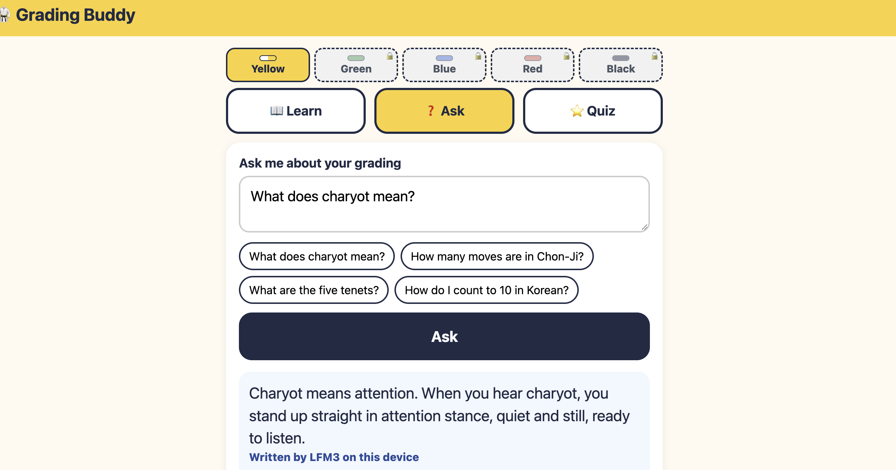

# Grading Buddy

LFM3-1.7B running offline, on your device, in the browser.

Can a small Liquid model do a real job with no signal? I built a study buddy for my kids' first Taekwon-Do gradings to find out. It runs [LFM3-1.7B](https://huggingface.co/LiquidAI/LFM3-1.7B) with Transformers.js on WebGPU. No server, no account, no API key. Once the model is downloaded, it works offline.



- **Live demo:** https://grading-buddy-lfm3-demo.pages.dev

## The problem

Between classes my kids forget the Korean words, the tenets and the moves of their first pattern, Chon-Ji. A chatbot will happily make things up, needs signal, and sends their questions off the phone. I wanted something that only answers from notes I've checked, and says so when it doesn't know.

## Quick start

You need Node 22.18 or newer (I used 24). Desktop only (a desktop browser with WebGPU).

```bash
git clone https://github.com/debs-obrien/grading-buddy-lfm3-demo.git
cd grading-buddy-lfm3-demo
npm ci
npm run dev
```

Open http://localhost:5173, press **Download and start** (about 1.1 GB, once) and ask "What does charyot mean?". `npm test` runs the tests; `npm run build` then `npm run preview` serves the built app so you can try it offline.

## Try the model in one file

Want just the model, no app shell? See [`examples/minimal`](examples/minimal): one HTML page that loads LFM3 with Transformers.js. Pure model out of the box; the full app adds topic notes and answer checks on top.

```bash
cd examples/minimal && python3 -m http.server 8000
```

Open http://localhost:8000 in desktop Chrome or Edge and click **Ask** (first run downloads about 1 GB; needs WebGPU).

## How it works

- LFM3-1.7B (q4f16) runs in a Web Worker on WebGPU with Transformers.js.
- A service worker caches the app and the browser keeps the model, so it works offline.
- Topic match picks the grading topic that best fits your question and gives the model that topic's facts.
- If nothing matches, the app says it's not part of the white to yellow belt grading and skips the model.
- The model is asked to answer in a sentence or two from those facts. A grounding check (Korean terms, numbers, type) and a required-facts check must pass; if either fails, the UI shows the note card labelled **From the notes** instead.
- Quiz questions and grading are plain code, straight from the notes (no model). Optional **Learn why** after a wrong answer is written by LFM3, with the same kind of check and a note fallback.

## Why this design

- Small models should get their facts from the app, not from memory. LFM3 docs: "Use retrieval or search for knowledge-heavy tasks." ([LFM3-1.7B](https://docs.liquid.ai/lfm/models/lfm3-1.7b))
- Liquid's cookbook describes the same pattern: "Small models are usually deployed with retrieval: your app finds a few relevant documents, and the model answers from them." It also warns the stock model "often writes the fallback sentence and then answers anyway, which an app can't rely on." That is why the app refuses out-of-scope questions before calling the model and checks answers afterwards. ([DPO notebook](https://github.com/Liquid4All/cookbook/blob/main/finetuning/notebooks/lfm3_dpo_with_trl.ipynb))
- Liquid's recommended fix for clean refusals is fine-tuning (DPO). This app does that job in code instead. The answer check and verbatim official wording are this app's own choices.
- Thinking is off ("Set enable_thinking=False ... for direct answers", [same LFM3 docs](https://docs.liquid.ai/lfm/models/lfm3-1.7b)). Decoding is greedy, as in Liquid's grounded-answer notebook. The general LFM3 default is light sampling. Greedy keeps the same question giving the same answer, so the eval is repeatable (some sentences are flatter than a sampled run).
- Browser runtime: ONNX in browsers via Transformers.js with WebGPU, fully client-side. ([ONNX](https://docs.liquid.ai/deployment/on-device/onnx))

## Why this model, approach and runtime

| Choice | Why | What it cost |
|---|---|---|
| **LFM3-1.7B** ([ONNX export](https://huggingface.co/onnx-community/LFM3-1.7B-ONNX), q4f16) | The text model in the LFM3 family: small enough for on-device Ask, strong at following “answer only from these facts” instructions, and the ONNX export is Liquid’s documented web path. | **About 1.1 GB** first download (q4f16). Without the notes and checks it can invent Korean words and advice. |
| **Transformers.js + WebGPU** | One static link, no server and no API key: the model runs in a Web Worker in the browser and works offline after the first download. | **Desktop only** (needs WebGPU). My CPU fallback failed twice, so there isn’t one. Slower than a native llama.cpp build. |
| **Topic match + LFM3 answers + grounding / required-facts checks, no fine-tune** | Fast to build and easy to check: match a whole topic, let LFM3 write one or two sentences from that topic’s facts, then either keep the answer or fall back to the note card. You can edit the notes without retraining. | When the grounding or required-facts check fails, the UI shows **From the notes** instead of the model’s wording. Two frozen-eval misses remain (see Does it work?). |

## Does it work?

The eval runs the app's topic match, prompt, grounding check and required-facts check on Node, on the CPU (q4 instead of q4f16), so you don't need a GPU.

```bash
npm run eval:match   # topic match / refusal only
npm run eval         # with notes, like the app (grounded Ask)
```

This repo has no `--no-retrieval` or `--open` baselines, so there is no no-notes column here. Grading, off-topic and quality numbers below are from the frozen question set (`eval/questions.json`). The everyday practice row is a separate, non-frozen practice set.

| | With notes (topic match + checks) |
|---|---|
| Grading questions right | **41 / 43** |
| Off-topic questions declined | **21 / 21** |
| Quality checks passed | **4 / 4** |
| Everyday practice set (not frozen) | **26 / 26** |

With notes, a real answer was: "Charyot means attention. When you hear charyot, you stand up straight in attention stance, quiet and still, ready to listen." The two graded wrong were "Why do I pull my toes back?" (model said to hit with the ball of the foot and mentioned the knee; the frozen `forbid_re` still fails that wording even though the notes include knee) and "what does chon-ji mean" (correct heaven/earth answer, but the frozen expect also wants 19). Of the 43 in-scope answers, 33 kept **Written by LFM3 on this device** and 10 fell back to **From the notes**. Match-only (`npm run eval:match`): **43 / 43** in-scope and **21 / 21** declined. Tokens/s on that Node CPU run: **5.91** (`eval/results/grounded.json`, Intel(R) Xeon(R) Processor x4, 17 GB RAM, Node v22.23.4; desktop/server CPU, not a Mac browser). It's small and keyword-graded, so it's a sanity check, not a benchmark.

## Where it falls short

- The first download is big, and you need WebGPU.
- I tested on iPhone and the part that loads the LFM model failed, so it's desktop only for now. The ConstantFolding session option in `shared/config.ts` did not make Ask reliable on iPhone; next step is native llama.cpp/GGUF.
- Speed numbers I have so far are Node CPU eval figures, not Mac browser timings yet.
- Some LFM3 answers still come out messy (repeated or cut off) and pass the checks. Fixes are in progress.
- Some everyday ways of asking, like "how many tenets are there", are still declined.
- Quiz "Learn why" is written by LFM3, but if its check fails you get the note instead.
- The notes are still a draft, so always follow your instructor.

## With more time

- Fine-tune with Liquid's [DPO notebook](https://colab.research.google.com/github/Liquid4All/cookbook/blob/main/finetuning/notebooks/lfm3_dpo_with_trl.ipynb) to answer from the notes or decline, and re-run the eval.
- Try [llama.cpp with LFM3-1.7B-GGUF](https://docs.liquid.ai/deployment/on-device/llama-cpp) natively and compare it with the desktop browser.
- Measure real speed and memory on a Mac desktop browser.
- Add a CPU fallback for browsers without WebGPU, and more belts.

## How I used AI

I drove and led this project, using Grok Bot, a team of AI agents, as my build crew. I planned it and talked it through over voice chat with my lead bot, which handed work to specialist bots for engineering, QA and design. The engineering bot sent the coding off to cloud agents, and the bots reviewed each other's work before anything got merged.

I steered every step. I chose the idea, the model and runtime, the scope and the study notes. I fed the agents Liquid's docs, model cards and other resources to study and follow, and I questioned everything they came back with. When the model's quiz explanations got details wrong, I made them stick to my notes. I dropped kid-friendly rewrites after two tries because the model kept inventing facts. I kept the app desktop only, since the LFM model part wouldn't load on iPhone.

## Licences and sources

**Model:** LFM3-1.7B by Liquid AI under the [LFM Open License v1.0](https://docs.liquid.ai/lfm/help/model-license) (downloaded at runtime, not in this repo; commercial use limited for companies with $10M+ annual revenue). **Code:** MIT. **Notes:** CC BY-SA 4.0. Sources: `data/belts/white-yellow/SOURCES.md` and `NOTICE`.
